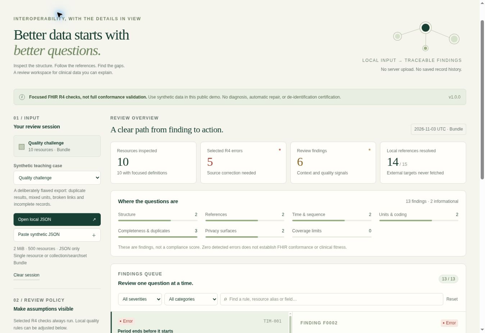

# FHIR Clinical Data Quality Lab

A browser-local workspace for reviewing a focused subset of FHIR R4 clinical data. It turns synthetic resources into a traceable findings queue, a reference map, and reports that omit imported field values and identifiers.

**[Open the demo](https://ysm19990103.github.io/fhir-clinical-data-quality-lab/)** · [How the checks work](docs/validation.md) · [Architecture](docs/architecture.md) · [Security and privacy](SECURITY.md)

Use synthetic inputs in the public demo. This is a portfolio and education project: it is **not a full FHIR validator, a de-identification tool, or a clinical decision system**. No API key, account, database, or backend service is required.



## What you can explore

- Load a synthetic case or import a local JSON resource or Bundle.
- Review selected structural errors, reference relationships, temporal conflicts, coding/unit review signals, possible repeated observations, and privacy-bearing field presence.
- Trace every finding to a rule, an explanation, a suggested review action, and an HL7 R4 source.
- Adjust optional completeness, consistency, and chronology policies. These local quality policies are distinguished from the implemented R4 constraints.
- Export JSON, CSV, FHIR R4 OperationOutcome, or a standalone HTML report. Reports use local resource aliases and structural locations; they omit source values, filenames, and original resource identifiers.

Focused resource checks cover **Patient, Observation, Encounter, Condition, DiagnosticReport, and MedicationRequest**. Collection and searchset Bundles are supported. Unknown resource types receive limited generic review with a coverage notice. Other Bundle workflows require workflow-aware validation.

## Run locally

Use Node.js 22 or later. The application has no third-party runtime or npm dependencies; an install step is unnecessary.

```sh
npm test
npm run build
npm run check
npm run dev
```

Open the local URL printed by the development server. The build creates `dist/` with content-addressed JavaScript modules and CSS. GitHub Actions runs the tests, build, and source/build checks before publishing the static demo to GitHub Pages.

For a local command-line review:

```sh
node scripts/audit.mjs synthetic-bundle.json --format json --review-date 2026-11-03
node scripts/audit.mjs synthetic-bundle.json --format outcome > outcome.json
node scripts/audit.mjs synthetic-bundle.json --format html > report.html
cat synthetic-bundle.json | npm run --silent audit -- --format csv > findings.csv
```

The CLI accepts a file or standard input. Formats are `json`, `csv`, `outcome`, and `html`; JSON is the default. Exit codes are `0` when no error-severity finding is produced, `1` when error-severity findings are produced, and `2` for an import or usage failure. Warnings and information still require review. A zero exit code does not establish FHIR conformance.

`npm run coverage` reports test coverage. `npm run check` checks JavaScript syntax and scans for selected credential patterns, contact email addresses, prohibited data-file formats, and application transport/persistence APIs. It is a heuristic safeguard, not a comprehensive security audit.

## Scope and deliberate limits

The ruleset targets **FHIR R4 4.0.1**. It checks selected fields and invariants rather than the full resource schema. It does not validate implementation guides, profiles, slicing, terminology membership, UCUM dimensional equivalence, clinical plausibility, authorization, consent, or server behavior. It never resolves remote references, converts units, corrects values, deletes duplicates, or writes back to a clinical system.

The bounded JSON parser rejects duplicate decoded keys, reserved object keys, oversized input, and numbers outside its supported precision. A parser limit means the input is unsupported by this lab; it does not mean the input violates FHIR. See [validation methodology and limits](docs/validation.md).

## Privacy by design

Import processing happens in memory in the browser. The app has no data-upload code, analytics, case persistence, database connection, or external script/font dependency. Imported narrative XHTML, attachments, and source values are not rendered in the review interface. Reports are constructed from an allowlisted analysis model.

These controls reduce exposure; they do not make arbitrary health data safe to use in a public demo. Hosting providers receive normal page/asset requests, browser extensions or a compromised device may inspect memory, and downloaded reports retain structural information. Clear the workspace when finished and manage exports under the appropriate data policy. See [SECURITY.md](SECURITY.md).

## Engineering evidence

The repository separates parsing, date semantics, reference resolution, rules, reporting, and UI code. The 82-test Node suite exercises parser boundaries, FHIR edge cases, regression scenarios, output privacy canaries, all report formats, and CLI behavior. Synthetic cases demonstrate both expected findings and scope limitations. The app's rule catalog and [methodology](docs/validation.md) make the reasoning inspectable.

This demonstrates healthcare interoperability, defensive input handling, testable domain logic, accessible browser interfaces, and static deployment without storing clinical records.

## Contributing

Use only synthetic examples. Do not attach patient records, credentials, private exports, or identifiable screenshots to issues or pull requests. Include a minimal synthetic reproduction, the rule identifier, and the expected behavior. Keep FHIR subset checks distinct from local policy rules and add a regression test for changes to analysis behavior.

Licensed under the [MIT License](LICENSE). FHIR is an HL7 standard; this independent project does not imply HL7 endorsement or certification.
