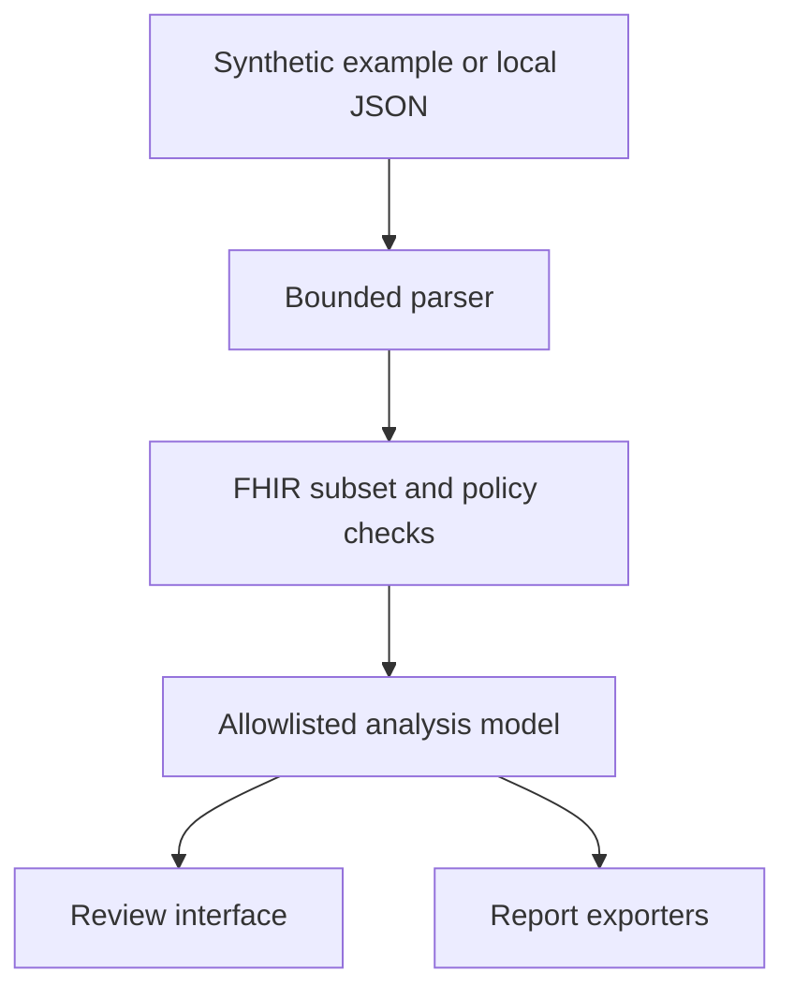

# Architecture

The lab is a dependency-free static web application with a shared analysis core for browser and command-line use. There is no application server, database, API credential, or background data synchronization.

## Data flow

The source resource remains in memory for the active review so policy changes can be reanalyzed. Rules can inspect it to compare references or selected fields, but their output uses fixed messages, aliases, and safe locations. The UI and report exporters work from this reduced model. The source is never rendered as narrative, followed as a URL, or included as a report attachment.

## Modules

| Module | Responsibility |
| --- | --- |
| `app/parser.mjs` | Bounded JSON parsing; duplicate-key, reserved-key, numeric-precision, and syntax checks; generic errors without input excerpts |
| `app/catalog.mjs` | Versioned rule metadata, severities, policy defaults, input limits, focused resource types, and official source links |
| `app/dates.mjs` | Calendar/primitive syntax, precision intervals, timezone-aware ordering, and explicit unmodeled temporal cases |
| `app/references.mjs` | Scoped contained, URN, absolute, relative REST, and version-specific reference resolution within the input |
| `app/engine.mjs` | Resource inventory, selected R4 constraints, local quality policies, privacy-surface checks, and sanitized output |
| `app/examples.mjs` | Built-in synthetic scenarios; no real clinical dataset |
| `app/exports.mjs` | JSON, CSV, R4 OperationOutcome, and standalone HTML reports from the analysis model |
| `app/ui.mjs` | Transactional imports, review screens, policy controls, and explicit downloads |
| `scripts/audit.mjs` | Local CLI using the same parser, engine, and report exporters |
| `scripts/build.mjs` | Static build with content-addressed module and CSS filenames |
| `scripts/check.mjs` | JavaScript syntax and selected credential/data/transport/persistence heuristics |

## Important design decisions

**Separate validity from usefulness.** A selected R4 constraint can produce an error. A local expectation, such as a subject for a resource where base R4 makes it optional, produces a policy finding. Coverage notices identify what the lab did not assess. No aggregate score is presented as a conformance certificate.

**Resolve only with defensible context.** Relative REST references need the source's server base. A bare type/id match across unrelated servers is not used. Ambiguous targets remain ambiguous, and external URLs are not fetched.

**Retain temporal uncertainty.** Partial dates represent intervals. Chronology findings require a definite ordering conflict rather than assuming a missing month, day, or timezone. Some syntactically accepted precision/leap-second cases are explicitly excluded from ordering.

**Make imports transactional.** The next analysis must parse and complete before replacing the active review. Import errors are fixed messages and positions, without source excerpts or filenames. Users can clear the current review; the app does not keep a case history.

**Keep reports separate from source data.** Resource aliases describe the current review and are not stable patient identifiers. Safe paths identify structure; a finding's OperationOutcome expression is a resource-level FHIRPath location. Reports omit input field values but still reveal structural characteristics.

## Deployment and reproducibility

The browser build is served from `dist/`. Its module URLs are content-addressed so a changed dependency produces a new filename. The source and generated build are scanned in CI, and the Pages deployment uses the resulting static artifact. No runtime secrets are needed.

A review records the application version, FHIR version, ruleset identifier, policy flags, and UTC review date. Supply `--review-date YYYY-MM-DD` to the CLI when reproducing date-sensitive results. Review aliases depend on input order; they are not durable identifiers across separate exports.

## Extending the lab

Add a rule to the catalog with its basis, severity, explanation, action, and source. Implement the check in the shared core and add a targeted synthetic regression test. If a change adds a new supported field, review both semantic coverage and the output allowlist. Never interpolate incoming values or arbitrary keys into a finding, error, rendered label, or export.

A full FHIR validator, terminology service, authorized FHIR server connection, or longitudinal patient store would require a different scope and security design. They are intentionally outside this static demonstration.
